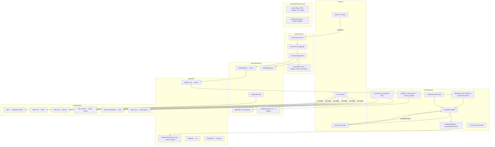

# Hapartition

A Redis-compatible TCP server with consistent hash sharding and gossip-based replication. Built for learning distributed systems: hash rings, SWIM gossip, LWW conflict resolution, and anti-entropy.

```
redis-cli -p 6379 SET mykey myvalue
redis-cli -p 6379 GET mykey
```

## Features

- **Redis wire protocol** — `SET`, `GET`, `DEL`, `PING` via RESP (Redis Serialization Protocol)
- **Consistent hash sharding** — Ketama-style ring with xxHash, virtual nodes, and `MOVED` redirection
- **Gossip membership** — SWIM protocol via HashiCorp Memberlist for node discovery, failure detection, and cluster membership
- **Replication** — owner and replica writes carry versions and origins; tombstones preserve replicated deletions
- **Write quorum** — `--w` controls required replica acknowledgements; default is all configured replicas
- **Anti-entropy** — periodic full-state sync cycles across peers for convergence after partitions
- **HTTP management** — `GET /info`, `POST /join`, ring and event endpoints; token-protected with HTTP Basic when configured
- **Pluggable discovery** — `Discoverer` interface for seed node resolution (static list, DNS, k8s headless service)

## Architecture



## Module responsibilities

### `cmd/hapartition/main.go` — Entry point

Parses CLI flags, wires all modules together, loads TLS config, and handles
`SIGINT`/`SIGTERM` orchestrated shutdown (HTTP first → gossip leave → Redis).

### `internal/server` — Redis-compatible TCP server

Listens on the Redis port, parses RESP protocol via `pkg/api`, dispatches
commands:
- **Key commands** (`SET`/`GET`/`DEL`) → hash ring lookup → local store or
  `MOVED` redirection
- **Cluster commands** (`CLUSTER SLOTS`/`NODES`/`INFO`/`KEYSLOT`) → ring
  introspection for cluster-aware Redis clients
- **Node commands** (`NODE.LIST`/`NODE.JOIN`) — direct cluster management

### `internal/gossip` — Memberlist wrapper

SWIM gossip via HashiCorp Memberlist. Handles:
- **Quorum replication** — writes and tombstones carry version and origin; each
  write waits for the configured number of replica acknowledgements
- **Replication** — receivers check `hashring.GetReplicas()` then merge entries
  by version with `store.SetWithVersion()`
- **Anti-entropy** — every 30s cycles through peers, exchanging full snapshots
  so missed writes and tombstones converge
- **Membership** — `NotifyJoin`/`NotifyLeave` callbacks update the hash ring
- **mTLS** — optional TLS transport for gossip traffic with peer verification

### `internal/mgmt` — HTTP management server

Serves alongside the Redis port on a separate listener:
- `GET /` — embedded dashboard HTML (`dashboard.html`) with hash ring
  visualization, live event log via SSE
- `GET /info` — JSON node info, members, key count
- `GET /ring` — hash ring snapshot (hex hashes per virtual node)
- `GET /events` — recent cluster events as JSON
- `GET /events/stream` — Server-Sent Events stream for real-time UI updates
- `POST /join` — validates seed address, joins via gossip, reports join failures

### `internal/hashring` — Consistent hash ring

Ketama-style ring with 256 virtual nodes per physical node and xxHash.
Binary search lookup for O(log N) key → node mapping. Supports:
- `GetNode(key)` — owner of a key
- `GetReplicas(key, n)` — next n distinct nodes clockwise (for replication)
- `GetSlotRanges()` — slot ranges per node for `CLUSTER SLOTS`
- `RingSnapshot()` — full sorted ring for dashboard visualization

### `pkg/store` — Versioned KV store

- `Set(key, value)` — assigns a monotonic local version
- `SetFrom(key, value, origin)` — returns a versioned entry with origin
- `SetWithVersion(key, entry)` — LWW merge, rejects stale versions
- `Snapshot()` — full entry dump, including deletion tombstones
- `Del(origin, keys...)` — replicates deletions as tombstones

### `pkg/api` — RESP protocol

Reader and writer for the Redis Serialization Protocol:
- `Reader` — parses `+OK`, `-ERR`, `:42`, `$6\r\nfoobar\r\n`, `*2\r\n...`,
  and inline commands
- `Writer` — serialises RESP values to the wire

## Quick start

### Single node

```bash
go build -o hapartition ./cmd/hapartition/
./hapartition --port 6379 --http 8080 --rf=1 --w=1
```

This configures single-node writes with quorum 1. The defaults (`--rf=2` and
all-replica write concern) require a second replica; otherwise writes return a
quorum error. Quorum is not silently lowered. The multi-node example below
keeps these defaults.

```bash
redis-cli -p 6379 PING
# → PONG

redis-cli -p 6379 SET hello world
# → OK

redis-cli -p 6379 GET hello
# → world

redis-cli -p 6379 DEL hello
# → (integer) 1

curl -s http://127.0.0.1:8080/info | jq .
```

### Multi-node cluster

Start three nodes (each in its own terminal or tmux pane). **Important:** on the same machine, each node needs a unique `--node-id` — `os.Hostname()` is identical for all processes, which breaks memberlist and the hashring.

```bash
# Terminal 1 — seed node
./hapartition --node-id node-a --port 6379 --http 8080 --gossip-port 7946

# Terminal 2 — joins node 1
./hapartition --node-id node-b --port 6380 --http 8081 --gossip-port 7947 \
  --join 127.0.0.1:7946

# Terminal 3 — joins node 1
./hapartition --node-id node-c --port 6381 --http 8082 --gossip-port 7948 \
  --join 127.0.0.1:7946
```

Now keys are distributed across nodes. A `SET` on the wrong node returns `MOVED`:

```bash
redis-cli -p 6379 SET mykey value
# → OK  (key owned by node 6379)

redis-cli -p 6380 SET mykey value
# → MOVED 127.0.0.1:6379  (redirect to owner)
```

## Configuration

| Flag | Default | Description |
|------|---------|-------------|
| `--node-id` | `os.Hostname()` | Unique node ID (required when running multiple nodes on the same machine) |
| `--bind` | `127.0.0.1` | Redis and HTTP listener host; non-loopback bind requires `HAPARTITION_AUTH_TOKEN` |
| `--gossip-bind-address` | `127.0.0.1` | Gossip listener host; non-loopback bind requires `HAPARTITION_AUTH_TOKEN` |
| `--port` | `6379` | Redis-compatible TCP port |
| `--http` | `8080` | HTTP management port |
| `--gossip-port` | `7946` | Memberlist gossip port (TCP+UDP) |
| `--join` | `""` | Comma-separated gossip seed addresses (`host:port`) |
| `--rf` | `2` | Replication factor |
| `--w` | `0` | Write concern; `0` means all configured replicas |
| `--tls-cert` | `""` | TLS certificate file for mTLS gossip |
| `--tls-key` | `""` | TLS private key file for mTLS gossip |
| `--tls-ca` | `""` | CA certificate file for verifying peer certs (falls back to system pool) |

`HAPARTITION_AUTH_TOKEN` enables Redis `AUTH <token>` and HTTP Basic auth
(token is the password; username is ignored). Redis, HTTP, and gossip bind to
loopback by default. Set a token before binding any of them to a non-loopback
address. The same token derives the gossip shared secret.

### TLS / mTLS

When `--tls-cert` and `--tls-key` are set, gossip traffic uses mutual TLS. Each
node presents its certificate; peers verify against the CA in `--tls-ca`.
The certificate SAN must include `hapartition`, used as peer `ServerName`.


### Discovery abstractions

For k3s or Kubernetes, implement the `Discoverer` interface:

```go
type Discoverer interface {
    Discover() ([]string, error)
}
```

The built-in `--join` flag uses `staticDiscoverer`. For k8s, write a DNS-based discoverer that resolves a headless service:

```go
type DNSDiscoverer struct {
    Service string // e.g. "redis-gossip.default.svc.cluster.local"
    Port    int
}

func (d *DNSDiscoverer) Discover() ([]string, error) {
    _, addrs, err := net.LookupHost(d.Service)
    // ... append port and return
}
```

## Kubernetes deployment

The `deploy/k3s/` directory contains manifests for running on k3s or any
Kubernetes cluster with cert-manager:

| File | Purpose |
|------|---------|
| `namespace.yaml` | `hapartition` namespace |
| `service.yaml` | Headless internal gossip service + ClusterIP Redis/HTTP service |
| `ca-bootstrap.yaml` | SelfSigned issuer + CA certificate bootstrap |
| `certs.yaml` | Per-node TLS certificates (cert-manager) |
| `deployment.yaml` | StatefulSet with per-node cert mounts |

Apply the namespace, then create required auth Secret before deploying:

```bash
kubectl apply -f deploy/k3s/namespace.yaml
AUTH_TOKEN="$(openssl rand -hex 32)"
kubectl -n hapartition create secret generic hapartition-auth \
  --from-literal=token="$AUTH_TOKEN"
```

Apply in order:

```bash
kubectl apply -f deploy/k3s/ca-bootstrap.yaml
# wait for ClusterIssuer/internal-ca to become Ready
kubectl wait --for=condition=Ready clusterissuer/internal-ca --timeout=60s
kubectl apply -f deploy/k3s/certs.yaml
kubectl apply -f deploy/k3s/service.yaml
kubectl apply -f deploy/k3s/deployment.yaml
```

Keep this shell open so `AUTH_TOKEN` is available for the local access commands.
Each pod gets its own TLS certificate from cert-manager, mounted at
`/etc/tls/<pod-name>/`. Gossip traffic uses mTLS with CA verification.

Redis and HTTP services are internal ClusterIP services. Access them locally
with port-forwarding:

```bash
kubectl -n hapartition port-forward service/hapartition 6379:6379 8080:8080 >/dev/null 2>&1 &
PORT_FORWARD_PID=$!
trap 'kill "$PORT_FORWARD_PID"' EXIT
sleep 1
redis-cli -p 6379 AUTH "$AUTH_TOKEN"
curl -u ":$AUTH_TOKEN" http://127.0.0.1:8080/info
```

## How it works

### Hash ring

The consistent hash ring (`internal/hashring`) uses 256 virtual nodes per physical node (`Ketama`-style). Key lookup is O(log N) via binary search on the sorted ring. The `getNode(key)` returns the owning node; `getReplicas(key, n)` returns the next n distinct nodes clockwise for replication.

```
Ring:   [nodeA:0] ─ [nodeB:42] ─ [nodeA:99] ─ [nodeC:150] ─ [nodeB:201] ─ ...
                ↑  key hash lands here → owner = nodeB
```

### Gossip replication

For `SET`, the owner writes a versioned entry locally, then sends it to replicas
and waits for the configured acknowledgement count. The count includes the local
write. `--w` selects the count from 1 through `--rf`; omitted or invalid values
default to all configured replicas. If the quorum is not reached, the command
returns an error, but the local write and writes already applied by replicas
remain. A quorum error does not roll back writes or mean the operation aborted
transactionally.

`DEL` also writes versioned tombstones locally, then waits for quorum
acknowledgements for each tombstone. Deletes that happened locally or were
already applied by replicas remain if a quorum error occurs; `DEL` is not
transactional.

Anti-entropy periodically syncs full store snapshots across peers in round-robin
order. Receivers merge entries by version, including tombstones, to recover
updates missed during outages.

### Membership

Memberlist handles all cluster membership:
- **Join** — a new node contacts seed nodes via `--join`
- **Failure detection** — SWIM protocol with suspicion and indirect probing
- **Leave** — graceful shutdown via `SIGINT`/`SIGTERM`
- The hashring updates automatically on `NotifyJoin` and `NotifyLeave` events

Memberlist delivers join and leave callbacks independently on each node. Nodes
can therefore temporarily have different replica rings during membership
changes. Until callbacks converge, clients can see `MOVED` redirects or quorum
errors caused by those differing rings.

### HTTP management API

| Endpoint | Method | Description |
|----------|--------|-------------|
| `/` | GET | Cluster dashboard (HTML with hashring viz, SSE event log) |
| `/info` | GET | Node ID, key count, member list |
| `/readyz` | GET | Unauthenticated readiness check; 200 only while this node is alive in gossip membership |
| `/ring` | GET | Hash ring snapshot (hex hashes, node assignments) |
| `/events` | GET | Recent cluster events (join, leave, key changes) |
| `/events/stream` | GET | Server-sent events (real-time cluster updates) |
| `/join` | POST | Join supplied gossip seed; returns non-success if joining fails |

## Project structure

```
cmd/hapartition/main.go     Entry point — flags, gossip setup, signal handling
├── internal/
│   ├── gossip/             Memberlist wrapper, broadcast, anti-entropy
│   │   └── pb/             Protobuf definition + generated code
│   ├── hashring/           Consistent hash ring (xxHash, virtual nodes)
│   ├── mgmt/               HTTP management server (GET /info, POST /join)
│   └── server/             Redis-compatible TCP server (RESP handler, dispatch)
├── pkg/
│   ├── api/                RESP protocol types, reader, writer
│   └── store/              In-memory KV store with versioning and LWW
├── go.mod
└── go.sum
```

## Redis commands

| Command | Status | Notes |
|---------|--------|-------|
| `PING` | ✓ | |
| `SET key value` | ✓ | Versioned replication; waits for configured quorum acknowledgements |
| `GET key` | ✓ | Returns value or nil |
| `DEL key [key ...]` | ✓ | Replicates versioned tombstones and waits for quorum acknowledgements; quorum errors do not roll back local or already-applied replica writes |
| `INFO` | ✓ | Redis-compatible server info |
| `CLUSTER SLOTS` | ✓ | Slot-to-node mapping for cluster-aware clients |
| `CLUSTER NODES` | ✓ | Node list with IDs and addresses |
| `CLUSTER INFO` | ✓ | Cluster state summary |
| `CLUSTER KEYSLOT key` | ✓ | Hash slot for a key |
| `NODE.JOIN key address` | ✓ | Adds node to hashring (doesn't affect gossip membership — use `--join` for that) |
| `NODE.LIST` | ✓ | Returns memberlist nodes and Redis addresses |
| `NODE.PING` | ✗ | Deprecated — memberlist handles health checks |
| `NODE.LEAVE` | ✗ | Deprecated — use shutdown to leave the cluster |

## Development

```bash
go build ./...
go test -race -count=1 ./...
go vet ./...
```

All tests pass under `-race`. Integration tests use [Testcontainers](https://testcontainers.com/) to spin up a real Redis instance for cross-validation. Benchmarks cover single-node and cluster workloads.

```bash
# unit + integration + race
go test -race -count=1 ./...

# benchmarks
go test -bench=. -benchmem ./...
```

### Adding a discovery backend

Implement the `gossip.Discoverer` interface and inject it via `Config.Discoverer`:

```go
import "github.com/peacewalker122/hapartition/internal/gossip"

type MyDiscoverer struct {
    // ...
}

func (d *MyDiscoverer) Discover() ([]string, error) {
    // return ["host:port", ...]
}
```

### Regenerating protobuf

```bash
protoc --go_out=. --go_opt=module=github.com/peacewalker122/hapartition \
  internal/gossip/pb/gossip.proto
```

## License

MIT
